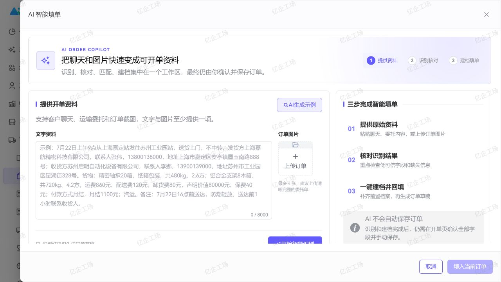
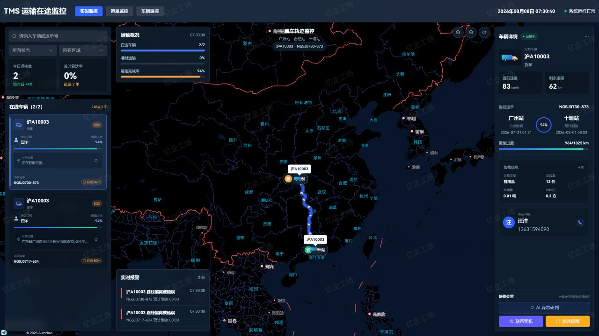

<div align="center">
  <h1>亿企工场 TMS</h1>
  <p><strong>覆盖主数据、开单、调度、运输执行、在途监控与签收协同的智慧运输应用</strong></p>
  <p>把客户委托、运输资源、履约过程、移动司机端与财务结算连接成一条可追踪的运输链路。</p>

  <p>
    <a href="https://gitee.com/art-si/art-supabase-tms">Gitee</a>
    ·
    <a href="https://github.com/art-si/art-supabase-tms">GitHub</a>
    ·
    <a href="https://gitee.com/art-si/art-supabase-pro">主平台</a>
    ·
    <a href="https://gitee.com/art-si/supabase-mobile-tms-driver">司机端</a>
    ·
    <a href="https://art-si.github.io/art-supabase-doc/modules/tms">使用文档</a>
  </p>
</div>

## 项目定位

亿企工场 TMS 是亿企工场的运输管理业务应用，面向物流运输从主数据、订单和运单生成，到配载、在途、签收与财务协作的完整履约过程。

本仓只维护 TMS 页面、业务 API、领域类型、运输规则与专属 Edge Functions。认证、租户、菜单、权限、布局、路由、公共组件、Store 和 Supabase 公共客户端由 [`art-supabase-pro`](https://gitee.com/art-si/art-supabase-pro) 统一提供。





## 核心能力

| 领域       | 已覆盖能力                                                                |
| ---------- | ------------------------------------------------------------------------- |
| 运输主数据 | 客户、客户地址、常用线路、货物、承运商、司机、站点、合同与客户/承运商价格 |
| 开单与订单 | 工作区开单、AI 文本/图片识别、主数据匹配、订单列表、订单详情与状态跟踪    |
| 运力与调度 | 运力规划、待运载、配载、司机车辆组合与运输资源校验                        |
| 运输执行   | 运单详情、运输事件、装卸货、发车、到达、签收、回单与异常处置              |
| 运营监控   | 实时在途地图、车辆/运单视图、线路绩效、运输告警与 AI 异常研判             |
| 跨域协同   | 司机移动端执行、VMS 车辆引用、FMS 费用/结算与平台审批工作流               |

## 标准履约链路

```text
客户委托
  → 开单 / AI 识别
  → 订单与运单
  → 运力规划与配载
  → 装货 / 发车 / 在途
  → 到达 / 卸货 / 签收
  → 回单 / 费用 / 对账与利润
```

AI 智能填单只生成可复核草稿；调度推荐和异常研判只提供辅助判断。保存、改派、签收、费用与状态变化仍由有权限的操作人员确认，并由服务端业务规则约束。

### 调度运单编号

- 普通配载沿用原始运单号；拆单按原始运单号依次生成 `-01` 至 `-99`；合单使用独立的 `DY` 调度号。
- 拆单序号按同一原始单的历史调度记录递增，已撤销的序号不复用。撤销的普通配载记录保留审计历史，当前有效调度号仍保持唯一。
- 编号由数据库 `tms_create_dispatch_plan_secure` 在锁定原始单后生成。2026-09-28 已将两条待接单的历史拆单号修正为 `YD202608-013-01`、`YD202608-013-02`；回滚验证、实际结果校验和有效运单号唯一性校验均通过。

### 运输订单报价

- 订单列表的“报价”操作打开报价表单。运输费、卸货费、送货费、保险费、税费与补充费用共同组成报价总额；从 `tmsOrderQuoteExpenseItem` 字典选中费用项后立即添加，可连续添加多项，当前字典为人工费、吊车费、其他费用。
- “保存报价”保留草稿；“提交报价”仅在系统内标记为已提交，不发送客户通知。报价独立存于 `public.tms_order_quote`，不改写订单应收费用；每单保留一份当前报价。附件最多 6 个，必须属于订单租户。
- 读写分别经 `tms_get_order_quote_secure`、`tms_save_order_quote_secure` RPC；菜单权限 `TmsOrderList:Quote`、订单字段权限、租户范围、金额与字典值由服务端复核。2026-09-28 使用事务回滚验证了同租户草稿与提交、金额合计、零额提交拒绝及平台全量、平台选定租户、普通用户的跨租户访问边界。

### 承运商多选资料

- `public.mdm_carrier.carrier_types` 和 `dispatch_channels` 保存承运商支持的全部类型和调度渠道；原有 `carrier_type` 和 `dispatch_channel` 保留首选值，供旧接口继续读取。数据库触发器维护两种表示的一致性，数组不允许为空或重复，渠道仅接受 `online`、`offline`。
- 新增和编辑通过 `tms_create_carrier_multi_secure`、`tms_update_carrier_multi_secure` 写入；原有安全 RPC 仍负责租户、业务操作及字段权限校验。列表类型筛选匹配数组内任一类型，导入支持多值，调度参选和详情回显全部渠道。
- 2026-10-18 已回填现有 3 条记录；以已有承运商的创建者身份调用安全更新 RPC，并用事务回滚验证了双类型、双渠道写入及首选值同步，回滚后原数据保持单值。模块边界、UI、类型、Lint、样式和 71 项单元测试通过。

### 基础资料补充

- “黑名单”“投诉咨询”“电子合同”“运输协议”分别存于 `tms_driver_blacklist`、`tms_service_case`、`tms_electronic_contract`、`tms_transport_agreement`。四页复用平台的查询表格、详情描述、上传控件与空状态组件。
- 服务单号、电子合同号、运输协议号通过系统编号规则按租户和月份生成，分别使用 `TS`、`DZHT`、`YSXY` 前缀与 3 位流水码。复制合同会生成新合同号，终止合同保留原记录。
- 普通用户只可读取所属租户的资料；四表各有一条按租户范围读取策略和三条平台超级管理员写入策略。新增、编辑、删除、复制及终止操作由数据库边界约束。承运商和车辆参选按租户筛选，运输协议保存车辆档案中的车型与车长快照。
- 合同复制与承运商参选 RPC 供已登录用户调用，函数内再次检查权限和租户范围；复制还检查平台超级管理员身份，普通用户的承运商参选结果不含联系人或法定代表人。
- 2026-09-29 为四页各创建 2 条演示记录，并以事务回滚验证了新增、编辑、批量删除、合同复制与终止、编号生成及跨租户读写边界。数据库性能顾问对四张新表无提示；安全顾问对上述两个已登录用户可调用的受控 RPC 仍给出常规 [`SECURITY DEFINER` 提示](https://supabase.com/docs/guides/database/database-linter?lint=0029_authenticated_security_definer_function_executable)。

## 司机端协同

独立的 [`supabase-mobile-tms-driver`](https://gitee.com/art-si/supabase-mobile-tms-driver) 提供 H5 与微信小程序司机工作台。司机可接单，完成装卸货定位打卡、发车、到达、签收、收车、凭证上传与费用上报；所有记录通过受控契约回流同一条 TMS 运单履约链路。

## 独立运行

环境要求：Node.js `>= 22.0.0`、pnpm `>= 11.9.0`。

```powershell
pnpm install
pnpm dev
```

默认访问 `http://localhost:3016`。使用在途地图时还需配置高德地图浏览器 Key、安全码和允许域名。

```powershell
pnpm check
pnpm build
pnpm preview
```

生产构建输出到 `docs/`，默认公共路径为 `/art-supabase-tms/`，可作为 Pages 发布目录。

## 与主仓协作

TMS 业务修改在本仓提交并推送，随后在主仓更新 `modules/art-supabase-tms` 子模块指针。数据库菜单继续使用稳定的 `/tms/...` 路由前缀；跨模块读取通过租户隔离、字段最小化的 API/RPC 契约完成，本仓不直接导入其他业务仓源码。

## 安全原则

- 前端菜单和按钮只改善交互，RLS、RPC 与 Edge Functions 才是最终授权边界。
- 普通用户只使用租户范围内的安全数据；受控写入和状态变化必须经过服务端校验。
- 前端只配置 Supabase `anon` / publishable key，服务端密钥不得进入 Vite 环境变量。

## 许可证

本项目采用 [MulanPSL-2.0](LICENSE) 许可证。

## 经营决策与运营管理报表

两个目录、十五个叶菜单使用路由与组件路径一致的独立入口，位于 `src/views/business-decision/**` 和 `src/views/operations-analysis/**`。页面权限由后端菜单控制；只读查询不新增业务写入动作。

### 页面职责

每个 `index.vue` 自己组合头部、指标、图表和台账，声明该页的列、跳转与统计说明。月度经营、各维度毛利分析使用金额对比图；应收、风险和运营过程台账以明细为主；运营 KPI 按六项目标列示实际值、完成率和预警。十五页都有可查询明细，但图表和业务指标按用途选择。

共享目录 `src/views/components/management-reports` 的职责限于：

- `workspace.vue`：页面布局与项目头部，无报表类型判断。
- `use-report-query.ts`：日期与关键词、分页请求、加载/错误状态、租户和路由查询变化。另保留最近一次成功查询的只读条件，六个经营分析页穿透使用该条件，未提交的输入不能改变已显示数据的下钻范围。浏览器覆盖未提交关键词、未提交日期及月度→客户→订单→车辆链路；完整回归 25 项通过，修正双请求加载测试后剩余 1 项复测通过。
- `report-trend.vue`、`comparison-chart.vue`：已准备好的图表标签、系列、单位和刻度，不判断页面业务。
- `report-cells.ts`：数字、利润结果、回单状态和受路由可用性约束的链接；不根据报表类型分支。
- `financial-comparison.ts`、`report-metrics.ts`：已归集收入成本比较及财务指标展示口径。
- `catalog.ts`：仅保留路由身份清单，无列、数据转换或页面业务逻辑。

金额对比图逐项保留可读数值：营收存在而成本未知时仍绘制营收，成本留空并提示未知/权限限制，不能把 `null` 转成零。两项均不可读的对象不绘制；全部不可读时显示空态。浏览器回归覆盖部分金额未知、全部未知，以及紧凑布局的表格可视高度。

### 数据与安全边界

入口 `public.tms_management_report(text,date,date,text,integer,integer)` 校验登录与精确报表权限。运营数据由私有只读查询 `app_private.tms_operational_report_rows` 按订单、车辆、司机和承运商各自粒度组织；私有函数不向 PUBLIC/anon/authenticated 授权。每个查询保持租户范围，普通用户伪造租户头不能改变结果。

金额先经过既有运单利润、客户对账单字段权限投影；任一必需金额不可读时不返回可倒推的汇总。财务按订单开单日期，收入按订单去重、已审核运单费用合并。多执行运单且无明确收入分摊时，单车/司机收入与毛利待核算。按执行运单关联车辆和司机，筛选在去重计算之后进行。查询跨度不超过一年，单页不超过 200 行，汇总与图表在分页之前计算。

月度总览按全部未取消订单统计运量（吨）与方量（m³），读取订单安全字段投影，重量由千克换算为吨，同一订单只计一次。未关联有效主运单的订单也纳入月度、客户、线路和订单报表，月度另列待归集订单数；此类订单成本、毛利及受影响的汇总保留待核算，不当作零成本盈利。现有八笔验收订单合计 80 吨、160 m³，SQL 回归校验该合计及完整订单计数。

单车盈亏另列已归集油费、路费，分别取已审核的 `fuel` / `toll` 运单费用，沿用费用明细安全投影并受汇总金额权限约束；查询日期、关键词和执行车辆与主表一致。零表示所选范围没有已审核的该类费用，不代表没有实际开支。充电、燃气等不混入油费，维修、工资、保险折旧仍需完整分摊。SQL 回归按原始已审核费用校验两项合计。

车辆调度是一车一行的当前快照，不因日期筛选隐藏档案；司机台账一名司机一行，任务、执行里程、考勤和事故使用明确关联。订单在途和回单以订单开单日期筛选；承运商按运单创建日期。回单合并订单、运单及签收记录凭证；上传不代表审核通过。异常覆盖回单异常工单及超期未签收提示，自动提示不视为已登记结案业务。

### 明确保留的业务缺口

当前毛利是已归集口径，不是完整车辆/司机净利润。月度总览已接入本年累计营收、已归集成本和毛利；预算对比、工资/折旧/保险的完整分摊仍未接入。应收已接入运输暂估下推的已审核财务应收、开票、收款/退款及其他核销；催收台账与风险分级尚未接入。经营风险已汇总车辆事故、违章与运输财务应收逾期，货损理赔尚未合并。

经营风险中的事故、违章按发生日期读取，沿用 `vehicle_accident_to_secure_json` / `vehicle_violation_to_secure_json` 的司机、描述与金额字段权限。已登记风险金额取事故公司承担金额或违章罚款，不等同于预计损失；没有明确来源的订单、客户及风险分级保留未知。风险首页按事项计数，不再使用签收、回单等履约指标。现有事故记录已通过源记录数量与安全投影一致性回归。已为原验收车辆创建两条带 `[TMS报表验收20261024]` 标识的违章测试记录，金额分别 100 / 200 元、状态分别未处理 / 已处理；均声明不代表真实交通违法。风险查询验证总额 300 元、无猜测订单归属及普通用户伪造租户头不改变结果，真实页面两条记录已视觉核对。

运营 KPI 已列六项目标；装载率采用运单重量/对应额定载重，准点率采用已到货且计划时间完整订单，回单及时率采用签收后 7 天内回收。尚缺重空驶里程、统一核损、期初期末应收余额及赊销收入，三项实际值保留待核算。位置、预计回场、维修计划、司机违章唯一关联、货损理赔和缺失原因等没有可靠来源的字段不补零或编造结论。

### 验证与证据范围

2026-10-24 应收查询已切换到财务链路：`fms_receivable_document.estimate_id` 关联 `source_type = 'tms_signed_waybill'` 的暂估应收，再关联真实运输运单与订单。按财务单业务日期筛选，已审核核销事件按所选结束日期截止；应收单逐笔展示到期日、币种、开票、净回款、其他核销与余额。

关联保持租户相等，并执行 `fms.receivable/amounts` 字段权限；暂估不重复计入应收。净回款仅含已审核收款与退款，其他核销单列。逾期依据实际 `due_date` 和未结余额；贷项不计逾期，缺少到期日保留未知。多币种保留明细、不合并金额汇总。现有两笔完整运输财务验收链路合计应收 3,000、净回款 1,650、余额 1,350，截至 2026-10-23 均逾期一天；SQL 回归验证全部/指定租户以及普通用户伪造租户头不改变结果。

主仓 `tests/integration/tms-management-reports.sql` 验证十五个查询、平台全部/指定租户、普通用户正向读取与伪造租户一致性、匿名拒绝、订单收入去重、实际车辆下钻、六项 KPI 未知值及一车一行。带 `报表验收` 标识的数据用于独立验收，八笔订单合计营收 80,000、已归集成本 74,000、毛利 6,000。应收使用 `TEST-AR-WAYBILL` 两笔完整财务链路，其余十四页使用原验收数据；十五页各有至少两行，数据保持原租户归属。

`tests/e2e/tms-management-reports.spec.ts` 直接加载各独立页面，覆盖十五个入口、浅色/深色、边框/阴影、1440/1024 宽度、查询重置、穿透、加载/空态/失败重试和专注模式。固定样例测试与真实账号截图分别保存于主仓 Git 忽略的 `.artifacts/tms-reports`；样例不替代生产数据验收。另以 20 行数据检查查询同排、输入宽度、图表高度和表格可视高度。

经营风险与应收跟踪共用私有查询函数 app_private.tms_receivable_report_rows，按财务业务日期筛选、结束日核销余额判定逾期。未知或无权查看的金额不参与逾期判定。风险金额保留原币种，到期日明确列示，状态为逾期未结，不推断催收进度。两条实际应收风险 450 / 900 与应收余额逐单一致；SQL 回归覆盖关联订单、币种、平台指定租户隔离及私有函数禁止直接调用。

客户和线路分析已增加订单运量（吨）与方量（m³）。与月度总览、订单维度共用订单货量投影，按订单去重；订单公斤换算为吨，未派车订单仍纳入，缺失值保持未知。验收八笔订单在各维度汇总均为 80 吨 / 160 m³。客户、线路统计说明分别按自身业务编写，移除误用的司机损益说明。
线路分析增加单位收入、已归集单位成本（元/吨），分别使用线路汇总营收、汇总成本除以去重订单运量，非逐票比值平均。运量非正或缺少金额时保持未知；浏览器验收覆盖横向滚动后的固定线路、1,200 / 900 数值及待核算显示。
单车与司机产值分析已增加承运运量（吨）与承运方量（m³），从每张有效执行运单的安全投影 cargo_weight_ton / cargo_volume_m3 读取并分别归集到车辆、司机。与客户/线路按订单去重的货量口径区分；不把整单货量重复归给各执行主体，任一缺失值保持待核算。两车、两司机验收样本各汇总 80 吨 / 160 m³。

### 2026-10-24 验收补充

重新读取平台已标星设计记录，选取同模块「常用线路」作为台账结构参考；已检查其运行页面和 `src/views/basic-data/favorite-route/index.vue`。报表沿用 BusinessWorkspaceHeader、BusinessTableWorkspaceActions、ArtTableQuery 与全高表格，保留项目主题及焦点模式。查询框采用用户明确要求的限宽同排布局，不照搬参考页更宽的多条件查询区。

专注模式从月度单页验证扩展到全部十五页：浅色 1440×900、深色 1024×900 下进入后隐藏页头与图表，保留查询和分页，表格体高度大于 400px；验证可见退出按钮及 Esc 恢复，15 项测试全部通过。证据位于 `.artifacts/tms-reports/all-pages-focus-e2e.log` 和各页面 `*-focus.png`。这是页面交互验收，不代表尚缺业务字段已完成。

现存「投诉咨询」模块使用 tms_service_case，含 service_type、waybill_no、submitted_at 和状态。后续应先验证同租户运单号唯一性与无效关联，再判断能否接入客户/承运商投诉次数；当前报表仍未包含该来源。

承运商「已关联投诉次数」已接入 tms_service_case：仅 complaint，提交日期与所选期间一致，并匹配期间执行运单。来源要求 TmsServiceCase:View 或平台超级管理员权限，否则返回未知。运单仅对未取消记录建立唯一索引，因此额外要求同租户全部历史中运单号唯一，避免取消历史同号引发错误归属；未关联、咨询及歧义记录不计入。零只代表没有可归属的已登记投诉，不代表无投诉。tests/integration/tms-report-carrier-complaints.sql 在回滚事务内验证两条关联投诉、咨询排除、未关联排除、取消历史同号排除；数据库原记录保持不变。浏览器已核对数量与待核算列。

客户和承运商投诉归属共用私有函数 app_private.tms_report_complaint_counts，禁止 PUBLIC/anon/authenticated 直接执行。客户按当前财务报表订单范围统计关联投诉，并排除分配订单含其他客户的合单运单；源查询维持租户、服务单查看权限、提交日期及运单号唯一性约束。客户页面增加已关联投诉次数，零仅表示没有可归属记录。事务回归包含两条投诉归属、多客户合单排除、咨询/未关联/取消历史同号排除，全部回滚；客户浏览器验收 3 项通过。
客户等级已从客户档案安全投影接入，沿用 tmsCustomerLevel 字典和 ArtDictDisplay 标签，未维护等级明确显示未维护。浏览器样例使用自定义字典标签验证不会硬编码 key 等内部代码；SQL 回归对照原客户档案等级。收款条件仍在财务应收单维度展示，不把条件名称推断成客户固定账期天数。
客户分析增加期间应收未核销余额、期间逾期金额与应收币种/范围，按 customer_id 聚合共用财务应收投影。业务日期范围与应收跟踪表一致，核销截至查询结束日，不宣称为包括期前单据的全部客户余额。金额按原 FMS 字段权限；客户多币种时两项金额为空并提示分币种查看，无期间单据且可读时显示零。真实财务客户余额已与应收投影回归核对，多币种展示通过浏览器样例验证。

### 成本与预算来源核查

2026-10-24 核查现有数据库：mdm_driver.employee_id 可以与同租户 fms_payroll_line.employee_id 关联，但现有 8 名司机均未关联员工，有效连接行数为 0。薪酬批次现有 paid / calculated 各 1 条；不能把已计算但未审核批次当作已确认工资。财务薪酬有 gross_amount、deduction_amount、employer_cost_amount、net_amount 及私有安全投影；接入必须同时执行 FinancePayroll 来源菜单权限、fms.payroll.employeeIdentity / salaryAmounts 字段权限及同租户同账套关联。应区分应发工资、扣减和雇主成本，并按已审核薪酬期间读取，不能按姓名猜测司机员工关系或重复加进已归集运单成本。司机员工映射及工资向车辆、订单分摊规则仍待确认。

fms_asset_depreciation_line 关联固定资产及折旧批次，fms_fixed_asset 有通用 source_type/source_id，但无直接 vehicle_id，未验证车辆映射前不能按资产名称或司机姓名匹配。现有预算表检索只发现 HR 调薪预算 hr_compensation_review_budget，不能作为运输营收或运营成本预算。月度预算、预算差异和完整利润仍未完成。

订单毛利页统计说明已独立修正：按订单去重收入并合并有效运单已审核费用，未派车/金额不可读保留未知，不再复用司机损益说明。

月度总览的金额卡片增加本年累计，起点为筛选结束日所在年份的 1 月 1 日，终点为筛选结束日，沿用同一关键词、租户和字段权限。页面独立查询年度汇总，图表与明细保留所选期间；年度数据失败时本次查询失败并清除旧汇总，未知成本/毛利不转为零。通过独立日期请求、空金额、失败清理、两条明细、明暗主题、专注模式与穿透筛选共 3 项浏览器回归；TMS 类型检查、ESLint 和 UI audit 通过。证据位于忽略目录 .artifacts/tms-reports/ytd-*.log 与 pages/monthly-ytd.png。

年累计边界补充验收：跨年区间 2025-12-01 至 2026-02-28 的年度请求从 2026-01-01 开始，关键词保持一致。真实数据库回归验证 limit=1 与完整分页的 summary 相同，验收年度营收 80000、已归集成本 74000、毛利 6000，且包含所选月份之前的收入。窄屏截止日期说明已精简并复查暗色截图；3 项月度浏览器回归及 UI audit 通过。

### 用户授权的测试口径与数据补齐

用户已授权采用合理默认规则并调整测试数据。已创建两个租户的司机职族、职务、岗位及 8 名测试员工，8 名司机均通过同租户 employee_id 关联，备份为 .artifacts/tms-reports/before-driver-employee-link.json。上文未关联结论为调整前核查结果，现已解除该数据缺口。

已落地回单默认时限为签收后 7 天。订单、运单及执行记录新增 receipt_collected_at，上传附件时自动记录实际时间，不再用签名时间充当回收时间；纸质登记与扫描归档分别展示。及时率分母为截至查询结束日已到期或已回收的签收订单；未到期未回收不计，已上传但缺时间时待核算。两笔 9 月验收订单分别第 2 天/第 9 天回收，数据库验证及时率 50%。回滚测试同时验证附件上传记录时间、函数不可直接调用；完整报表 SQL、类型检查、UI audit 和回单明暗主题/专注模式浏览器测试通过。

待实施的默认口径：货损率按已确认货损金额/营收；工资、保险、折旧优先按月度里程分摊，缺里程按承运订单数并显示依据；承运商准点、回单、无异常、无投诉权重分别为 40%、30%、20%、10%。这些约定尚未全部接入，不能视为已完成核算。

承运商考核已接入回单及时率及综合评分：准点 40%、回单 30%、无延误 20%、无投诉 10%；投诉得分下限为零，任一组成项缺失或无查看权限时总分和等级待核算。A/B/C/D 分界为 90/80/70，结算建议仅展示、不改变业务状态。回单按该承运商关联订单去重并沿用 7 天规则。两家 9 月验收承运商补齐到达时间后分别为 100/A 与 10/D，事务回归验证缺到达时间会撤销评级。当前异常项采用延误率，货损仍待接入。备份为 .artifacts/tms-reports/before-carrier-score.json 和 before-carrier-arrival.json。3 项浏览器回归、SQL 回归、类型检查和 UI audit 通过。

司机薪酬已接入 private tms_driver_payroll_rows：按同租户 employee_id、同账套批次关联，只读当前已审核/已发放且薪资月份落在查询覆盖月份内的整月工资，月份及币种单列。来源 FinancePayroll 菜单与 employeeIdentity/salaryAmounts 字段权限同时生效；跨账套不合计，未知不补零。前端新增应发、扣减、雇主承担费用、实发四列，不重复加进运单成本。

9 月测试期间经备份后开放，两名已关联司机通过本租户有权限账号调用现有创建/明细/审核 RPC 完成批次，合计应发 17000、扣减 500、雇主承担 2500、实发 16500。未执行薪资支付。回滚回归覆盖平台全量/选定租户/普通用户/伪造租户头、未审核排除及无来源权限；数据库、3 项司机浏览器回归、类型和 UI audit 通过。备份 .artifacts/tms-reports/before-driver-payroll.json。工资分摊进车辆/订单成本仍待实施。

薪酬分摊已接入六个经营维度，新增分摊薪酬、分摊依据、含薪酬成本、含薪酬毛利。原始运单费用和已归集毛利保留；薪酬基数为应发加雇主承担费用，按司机及订单创建月份整月固定分配后再筛选。全量执行里程完整且大于零时按里程；否则按不同订单数，同单多运单均分。人民币单账套可核算，缺来源或权限不补零，尾差归固定排序最后运单。9 月验收薪酬 19500 在月度/车辆/司机/订单/线路/客户六个维度一致；单车筛选仍为 9200。回滚测试覆盖 1:1:1:4 里程权重、5257.13 尾差结果及缺里程后每单 2300 的回退结果。保险与折旧仍未计入完整成本。证据 .artifacts/tms-reports/payroll-allocation-*.log；数据库函数备份 before-payroll-allocation.json。

单车报表新增期间保险摊销：复用车辆保险单，商业险和交强险分别按投保日至到期日（含首尾）平均分摊，再汇总查询日期内重叠天数。来源菜单权限、保费字段权限和同租户车辆关联均保留；缺日期、保费或无期间记录显示待核算。该列按车辆自然日期计算，尚未向订单分摊，尚未纳入完整经营成本。两台验收车通过现有创建保险 RPC 建立全年测试保单，9 月分别 330/660 元，跨年边界单日合计 33 元。事务回归覆盖日期边界、缺日期、平台全量/选定租户/普通用户/伪造租户头以及私有函数授权。SQL 主回归和两项浏览器回归通过；截图核对固定车牌、保险金额、横向滚动和表格空间。备份 `.artifacts/tms-reports/before-insurance-period.json`，证据 `.artifacts/tms-reports/insurance-period-*.log`。固定资产目前无车辆关联，不使用名称猜配折旧。

保险订单分摊后续已接入六个经营维度：按车辆与订单创建月份固定分摊整月保费，完整里程优先，否则按不同订单数，同单多运单均分。尾差归固定排序最后运单，筛选不改变分配基数。分摊金额与分摊依据独立列示，尚未直接叠加到已有成本，避免既有保险费用重复计费；无承运订单的车辆保费仍未分配。9 月六维度均核对为 990 元，单车筛选为 330 元；事务测试覆盖 1:1:1:4 里程的 188.58 元尾差、缺里程后的每单 82.5 元、租户隔离与私有函数不可直接执行。备份 `.artifacts/tms-reports/before-insurance-allocation.json`；回归 `tests/integration/tms-report-insurance-allocation.sql`。

在途监控清理了已失效的 polling-subscription 导入、转发导出及重复订阅调用，沿用页面已有的 VueUse 60 秒刷新和手动刷新。浏览器计时回归确认首次加载一次、30 秒不额外请求、每分钟一次；位置查询超时恢复回归通过，截图复核首屏及下方记录。当前全仓 vue-tsc 检查完成且退出码为 0，ESLint、Prettier 与 UI audit 通过；证据为 .artifacts/tms-reports/monitor-refresh-*.log。资产车辆关联仅完成结构调查与备份，尚未实施，不能据此视为折旧已接入。

货损率已按本期创建订单关联的已审核货损赔付 / 同批订单营收接入运营 KPI，订单收入去重，未审核费用不计入，金额权限不足或营收为零保留待核算。两笔真实测试费用通过既有审批流程，合计 300 元；验收订单收入 80000 元，对应 0.375%，目标 ≤0.1%，预警未达标。已有成本已包含货损费用，不再次叠加。数据库主回归及货损回归日志已核对，2026-10-24 再查询确认两笔均 approved。独立端口 41749 浏览器回归通过，复核 1440 明色与 1024 暗色截图；此前 41746 日志中的 Pinia/路由注入错误在当前独立运行未复现，原因未作结论。此处浏览器使用响应样例，不能替代全部页面真实接口验收。证据：.artifacts/tms-reports/damage-kpi-recheck.log、pages/operations-kpi-light.png、pages/operations-kpi-dark.png；备份 before-damage-kpi.json。货损尚未贯通承运商、客户与风险报表；空驶率、应收周转仍待完成。
